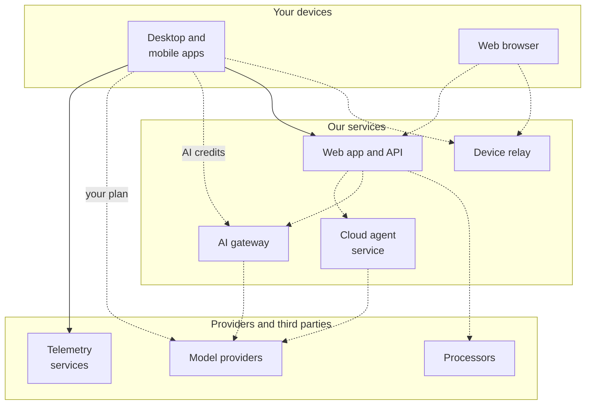
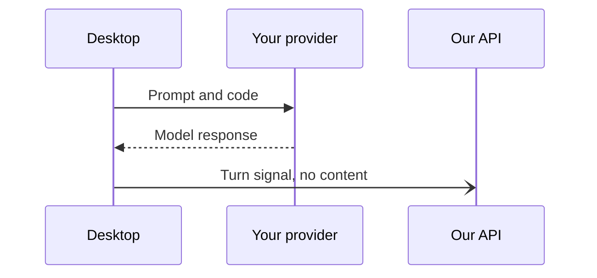
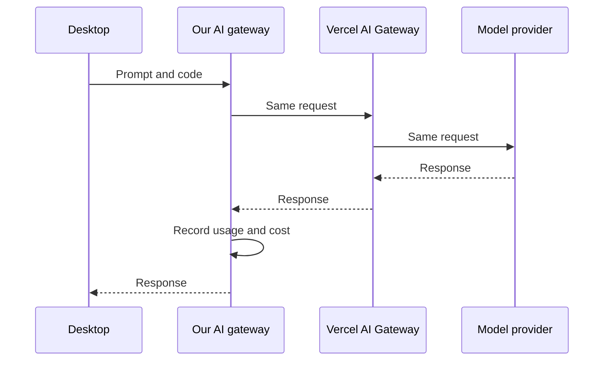
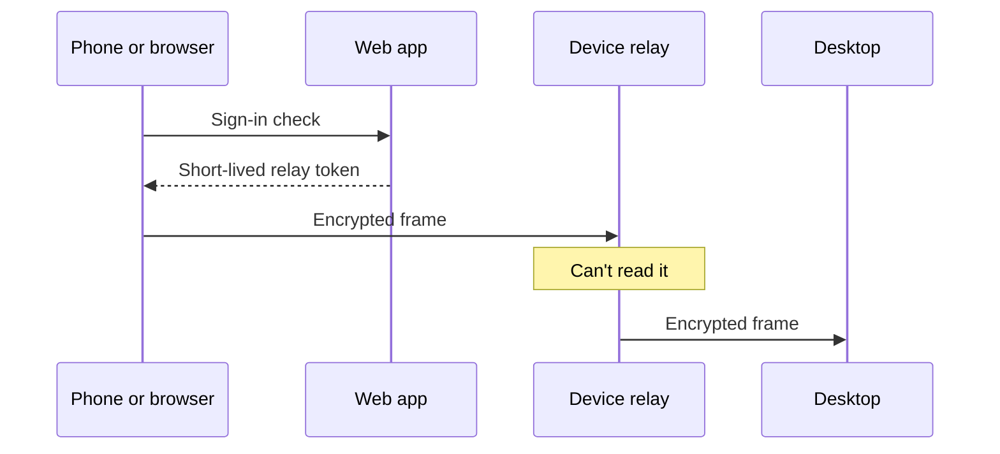

# What runs on our servers

The Unstoppable Code desktop and mobile apps in this repository are open
source. Some of their features rely on services we run, and those services stay
closed source. This page lists each one: what it does, which features depend
on it, what data it handles, and what you'd need to replace to run without it.

It's written for two kinds of reader:

- **Security and privacy reviewers** who need to know what data reaches us and
  why.
- **Self-hosters** who want to know what to replace to run the apps on their
  own infrastructure.

It covers the desktop and mobile apps. Browsing our website is covered by our
[privacy policy](https://unstoppable.ai/privacy).

## At a glance

- **Your code stays on your machine.** Your projects, worktrees, code graph,
  and local memory stay on your computer unless you use one of the features
  listed below.
- **Your own plan goes straight to your provider.** With your own Claude,
  ChatGPT, or Cursor plan, prompts and code go from your computer to that
  provider, not through us.
- **These features send content to us:**
  - AI credits and hosted models
  - Auto model selection
  - Organization memory
  - The Remote Control inventory: your skills, plugins, MCP servers,
    Collections, marketplaces, and pipelines
  - Outside agents you connect through our MCP server
  - Cloud chats
  - Sharing runs and publishing to the marketplace
  - Feedback reports and message ratings
  - Activity sharing, which is off by default
- **Remote Control and Remote access are end-to-end encrypted.** From a
  browser, the mobile app, or another computer, the relay that connects your
  devices can't read what they send. The one exception is an outside agent you
  connect through our MCP server: its requests pass through our servers.
- **Released apps send telemetry, and you can turn it off in the app.** Every
  flow the product works without has a switch: **Settings → Privacy → Usage
  data** on desktop, and **Settings → App** on mobile. All of them start on.
  Organization admins can turn some of them off for members on desktop. See
  [Telemetry and diagnostics](#telemetry-and-diagnostics).
- **Our privacy policy describes what we keep, how long we keep it, and how we
  use it.**

## System map

Solid arrows carry data whenever a released app runs. Dashed arrows carry data
only when you use that feature. The desktop app also checks our update feed,
which isn't shown here.

## What leaves your device, by feature

| Feature                       | Goes to             | What's sent                                                                                                                                       | On by default?                       |
| ----------------------------- | ------------------- | ------------------------------------------------------------------------------------------------------------------------------------------------- | ------------------------------------ |
| Sign-in and account           | Web app and API     | Your name, email, and sign-in provider details                                                                                                    | Only if you sign in                  |
| Chats on your own plan        | Your provider       | Prompts, code, and tool output. Not us.                                                                                                           | Yes                                  |
| AI credits and hosted models  | AI gateway          | The full model request, with project and worktree names                                                                                           | When you pick a hosted model         |
| Auto model selection          | Web app and API     | Your prompt and recent messages, trimmed                                                                                                          | When you pick **Auto**               |
| Organization memory           | Web app and API     | Transcripts you share with your organization                                                                                                      | Set by what you share                |
| Activity sharing              | Web app and API     | Only the kinds you choose: usage, plans, summaries, transcripts                                                                                   | No                                   |
| Feed sync                     | Web app and API     | Feed entries from your work                                                                                                                       | Only with summaries shared           |
| Remote Control                | Device relay        | Encrypted frames the relay can't read, plus device IDs                                                                                            | No, you start it                     |
| Remote Control inventory      | Web app and API     | Your computer's name, and names, descriptions, and display details of your skills, plugins, MCP servers, Collections, marketplaces, and pipelines | Yes, while Remote Control is enabled |
| External agents (MCP)         | Web app and API     | Requests from an outside agent you connect, and a record of each call. What it reads goes to that agent's provider.                               | No, you connect one                  |
| Remote access between devices | Device relay        | Encrypted frames the relay can't read, plus device IDs                                                                                            | No, you pair devices                 |
| Cloud chats                   | Cloud agent service | Your prompts and the chat. The agent runs on our side.                                                                                            | When you start one                   |
| Sharing and the marketplace   | Web app and API     | The run, pipeline, skill, or agent you share or publish                                                                                           | When you share                       |
| Feedback reports              | Web app and API     | Your message, and diagnostics unless you untick them                                                                                              | When you send one                    |
| Message ratings               | Web app and API     | The rating, reasons, and model, plus your comment on a thumbs-down                                                                                | When you rate                        |
| Push notifications (mobile)   | Web app and API     | Your device's push token                                                                                                                          | After you sign in                    |
| Update checks (desktop)       | Update feed         | A request for your platform's update file                                                                                                         | Yes, in released builds              |
| Skill safety check (desktop)  | Vercel skills audit | The GitHub repository name and the skill names                                                                                                    | Yes, when you browse skills          |

How to stop each one:

- **Sign-in:** sign out. Features that need an account stop working.
- **Hosted models and Auto:** pick a model from your own plan, a local model,
  or [your own AI gateway](docs/ai-gateway.md).
- **Activity sharing, Feed sync, and organization memory:** set each kind of
  activity to **Off** in **Settings → Privacy**. Organization memory only reads
  transcripts you share with your organization. Organization admins can also
  exclude members from it.
- **Remote Control and Remote access:** stop the session, or turn off
  **Remote Control** in **Settings → Labs** on the desktop. That also stops
  the Remote Control inventory.
- **Feedback reports:** untick diagnostics before you send a report.
- **Push notifications:** sign out of the mobile app.
- **Update checks:** turn off **Check for updates automatically** in
  **Settings → General → Updates**. The desktop app then checks only when you
  click **Check for updates**. Builds from source don't check for updates.
  If the app can't read your settings, it keeps checking, so security fixes
  still arrive.
- **Skill safety check:** turn off **Skill safety check** in **Settings →
  Privacy → Usage data**. Skills then show no risk rating. If the app can't
  read your settings, the check stays on, because it protects you.
- **Telemetry:** turn off each flow in **Settings → Privacy → Usage data** on
  desktop, or **Settings → App** on mobile. See
  [Telemetry and diagnostics](#telemetry-and-diagnostics).

## Telemetry and diagnostics

Released apps send this telemetry. Every switch starts on.

| Service      | App     | What it gets                                                                                                 | Switch                                                  |
| ------------ | ------- | ------------------------------------------------------------------------------------------------------------ | ------------------------------------------------------- |
| PostHog      | Desktop | Product events, error reports, and session replays from a random install ID, plus your email domain          | Usage analytics, Session recordings, and Error reports  |
| LaunchDarkly | Desktop | Details used to pick feature flags: your account and connected-provider emails, system, and organization IDs | Personalized feature rollouts (anonymous mode, not off) |
| Our API      | Desktop | One signal per chat turn, with no content                                                                    | Active use count                                        |
| Crashlytics  | Mobile  | Crash reports                                                                                                | Crash reports                                           |
| PostHog      | Mobile  | Events from the app rating prompt only, from an anonymous ID                                                 | Usage analytics                                         |
| Our API      | Mobile  | One anonymous notice the first time the app opens                                                            | None. It's sent once, before you can open Settings      |

The desktop switches are in **Settings → Privacy → Usage data**, and the mobile
switches in **Settings → App**. With both Usage analytics and Error reports off,
the desktop app doesn't start PostHog and creates no PostHog install ID.
Session recordings also stop while Usage analytics is off.

Organization owners and admins can turn off Usage analytics, Session
recordings, Error reports, Active use count, and Personalized feature rollouts
for members in **Organization settings → Policies → Member usage data**. This
applies to the desktop app while you work in that organization, and never to
your Personal work or the mobile app. It only turns flows off: anything the
organization leaves on follows your own choice, and leaving the organization or
switching to Personal restores it. If the desktop app can't read your account's
organization policies, it keeps those five flows off until it can. Desktop
versions released before this setting ignore it until they're updated.

The details:

- **PostHog (desktop)** uses a random install ID and never your account ID. It
  gets the domain of your account email, for example `example.com`, never the
  full address. Session replays record the app's screens. They replace what you
  type into fields with asterisks, redact credentials, hide chats and the
  message box, and show project, chat, and worktree titles as asterisks. Other
  text on screen, such as branch names, can still appear. Error reports carry
  the error type, a message cut to 2,000 characters, and up to 50 stack frames.
  PostHog can work out an approximate location from your IP address.
- **LaunchDarkly (desktop)** decides which features you see. By default it
  gets your account email, the emails and usernames of the GitHub, Claude, and
  Codex accounts you've connected, your operating system, CPU architecture, and
  app version, and your organization and team IDs. With **Personalized feature
  rollouts** off, it gets an anonymous context instead: a random install key,
  your operating system, CPU architecture, and app version, and your
  organization and team IDs, so features your organization turns on still
  reach you. Feature flags keep working, so this switch can't turn
  LaunchDarkly off.
- **The turn signal (desktop)** goes to our API once per chat turn. It carries a
  one-way hash of an internal turn ID, the organization ID for organization
  work, and the app version, and it's sent with your account sign-in. It never
  includes your prompt, the model, the project, or any path or file name. It
  doesn't depend on activity sharing; turn off **Active use count** to stop
  it.
- **Crashlytics (mobile)** gets crash reports from Firebase. The app doesn't
  attach your account to them.
- **PostHog (mobile)** gets only the app rating prompt events. It uses an
  anonymous ID, creates no person profile, and doesn't use your IP address for
  location. Events queued just before you turn **Usage analytics** off may
  still be sent.
- **The first-launch notice (mobile)** goes to our API once per install. It
  carries only the platform, iOS or Android.

Our instrumentation rules keep prompts, transcripts, file contents, and
terminal output out of events and error reports. Error reports also remove
token-like secrets, such as API keys, and replace your home folder and local
file links in paths. Other text in an error message, such as folder and file
names or a Git remote address, can still appear. Analytics events and error
reports never include a full email address. LaunchDarkly gets the emails listed
above, to choose feature flags.

Builds from source don't check for updates. By default they send the same
PostHog events and error reports as released builds, but don't record PostHog
session replays. A fork can turn analytics off when it builds; see the
[desktop build instructions](clients/desktop/README.md).

## How data flows

### A chat on your own plan

### A chat on AI credits

### Remote Control and Remote access

A browser, the mobile app, or another computer reaches your desktop through the
device relay. The web app only checks your sign-in and issues a short-lived
token for the relay.

## Hosted services

### Web app and API

**What it does:** accounts and sign-in, organizations, teams and policies,
billing and AI credits, sharing and the marketplace, Remote Control tokens and
inventory, Feed sync, organization memory, notification settings, and feedback
intake. It also hosts an MCP server that lets outside agents act for you.

**Features that depend on it:** everything that needs an account.

**Data it handles:**

- Your account profile, organization membership, and settings.
- Billing records, and usage and cost records for AI credits.
- What you share, publish, or sync.
- For Remote Control, your computer's name and the names, descriptions, and
  display details (such as an MCP server's address and which items are
  installed) of your skills, plugins, MCP servers, Collections, marketplaces,
  and pipelines, with no credentials or contents. It syncs while Remote
  Control is enabled, even before you pair a device. The chats, commands, and
  results themselves go through the device relay, encrypted end to end.
- Requests from outside agents you connect through the MCP server, and a
  record of each call they make.
- Feedback reports and message ratings.
- Some content, such as transcripts and plans, is encrypted when stored. We
  hold the keys, so this isn't end-to-end encryption.
- Selected tables are copied to our analytics warehouse: account and sign-in
  records, usage and cost records, chat summaries, and pipeline definitions.
  Transcript bodies are not copied.

**Without it:** you can't sign in, so every feature that needs an account
stops working.

**Replacing it:** it's an HTTPS REST API. We don't publish a spec for it yet.
See [Running without our services](#running-without-our-services).

### AI gateway and AI credits

**What it does:** forwards requests for hosted models to model providers
through Vercel AI Gateway, and charges their usage to AI credits.

**Features that depend on it:** AI credits and hosted models, **Auto** model
selection, and organization memory.

**Data it handles:**

- The full model request passes through it: prompts, code, and tool output.
  We keep usage records, such as the model, tokens, cost, and project and
  worktree names, but not the prompts.
- For **Auto**, our server sends your prompt and recent messages through Vercel
  AI Gateway to a third-party routing model, with zero data retention
  requested, and keeps only the chosen model and a digest.
- For organization memory, our server sends transcripts shared with your
  organization through Vercel AI Gateway to process, embed, and rank them.
- If you connect your own AI gateway while signed in, its URL, name, and model
  list are saved to your account. Signed out, they stay on your computer. We
  never store your API key. If you connect from the web, our server uses it
  once to list your models.

**Without it:** you can't use AI credits, hosted models, **Auto**, or
organization memory.

**Replacing it:** use your own Anthropic- and OpenAI-compatible gateway for
Claude Code and Codex chats. See the [AI gateway guide](docs/ai-gateway.md).

### Cloud agent service

**What it does:** runs cloud chats in sandboxes on our side and keeps their
history.

**Features that depend on it:** cloud chats.

**Data it handles:** your prompts, the chat history, and the files the agent
works on in its sandbox. Sandboxes run on Vercel Sandbox, and their usage is
billed to AI credits.

**Without it:** cloud chats aren't available. Chats on your computer still
work.

**Replacing it:** there's no replacement today.

### Device relay

**What it does:** connects your devices for Remote Control and Remote access,
such as your phone or a browser to your computer.

**Features that depend on it:** Remote Control from a browser or the mobile
app, Remote access between devices, and **Connect a computer** in the mobile
app.

**Data it handles:** it routes end-to-end encrypted frames between devices that
you paired. It can't read them, and it stores nothing. Its logs can include
device IDs and error reasons.

**Without it:** Remote Control and Remote access don't work.

**Replacing it:** it's a WebSocket relay.

### Email and push notifications

**What it does:** sends email through SendGrid, and push notifications through
Firebase Cloud Messaging and, on iOS, Apple's push service.

**Features that depend on it:** account email and mobile notifications.

**Data it handles:** your email address and the email's content, and your
device's push token. Our server writes each notification's text, which can
include a line from a chat summary or a branch name.

**Without it:** you don't get email or push notifications.

**Replacing it:** there's no replacement today.

### Updates and downloads

**What it does:** serves desktop updates from `releases.unstoppable.ai` and
installers from [unstoppable.ai/download](https://unstoppable.ai/download).

**Features that depend on it:** automatic desktop updates.

**Data it handles:** the request for your platform's update file, a few
seconds after launch and then every four hours.

**Without it:** released apps don't update themselves. Builds from source
don't check for updates.

**Replacing it:** build from source.

## Third-party processors

| Provider     | Used for                                             | Data                                                            |
| ------------ | ---------------------------------------------------- | --------------------------------------------------------------- |
| Stripe       | Billing                                              | Billing details and purchases                                   |
| Vercel       | AI Gateway and Sandbox                               | Hosted model, Auto, and organization memory requests; sandboxes |
| Google Cloud | Hosting, storage, analytics warehouse, avatar checks | What our services store. Avatar uploads get a safety check.     |
| SendGrid     | Email                                                | Your email address and the email's content                      |
| Firebase     | Push notifications and mobile crash reports          | Push tokens, notification text, and crash reports               |
| Apple        | iOS push notifications                               | Push tokens and notification text                               |
| PostHog      | Product analytics and error reports                  | See [telemetry](#telemetry-and-diagnostics)                     |
| LaunchDarkly | Feature flags                                        | See [telemetry](#telemetry-and-diagnostics)                     |
| Linear       | Feedback reports                                     | Your report and any diagnostics you include                     |
| GitHub       | Our GitHub App, cloud chats, and marketplace sources | Pull request details and repositories you connect               |
| Sign-in      | Google, GitHub, and Apple on iOS                     | Your name, email, and profile from that provider                |

Some traffic goes from your computer straight to a provider with your own
account. It doesn't pass through us, and those providers aren't our
processors:

- **Model providers** such as Anthropic, OpenAI, and Cursor, when you use your
  own plan.
- **GitHub**, for repository access and pull requests with your own token.
- **Your own AI gateway**, when you connect one.

Chats with local models go to the model host you choose, usually your own
computer. The skill safety check also goes straight from the desktop app to the
Vercel skills audit, without your account.

## Running without our services

| Feature                                 | Fully local | Bring your own | Hosted by us                          |
| --------------------------------------- | ----------- | -------------- | ------------------------------------- |
| Chats on your own plan                  | Yes         |                |                                       |
| Local models                            | Yes         |                |                                       |
| Worktrees, pipelines, and local memory  | Yes         |                |                                       |
| Your own AI gateway                     |             | Yes            | Stores settings when you're signed in |
| AI credits, hosted models, and **Auto** |             |                | Yes                                   |
| Sign-in, organizations, and policies    |             |                | Yes                                   |
| Remote Control and Remote access        |             |                | Yes                                   |
| Cloud chats                             |             |                | Yes                                   |
| Sharing and the marketplace             |             |                | Yes                                   |
| Push notifications                      |             |                | Yes                                   |

"Fully local" means it works without our services. Chats on your own plan
still go to your provider.

If you point the apps away from our services, you lose or need to replace:

- [ ] Sign-in and accounts
- [ ] Organization policies
- [ ] AI credits and hosted models
- [ ] Remote Control and Remote access
- [ ] Sharing and the marketplace
- [ ] Cloud chats
- [ ] Push notifications

How to point the apps elsewhere:

- **Desktop:** the service addresses are build settings. See the
  [desktop build instructions](clients/desktop/README.md). Changing them
  doesn't turn analytics off; see
  [Telemetry and diagnostics](#telemetry-and-diagnostics).
- **Mobile:** set the `UNSTOPPABLE_CODE_API_BASE_URL_PRODUCTION` and
  `UNSTOPPABLE_CODE_API_BASE_URL_STAGING` build defines. See the
  [mobile build instructions](clients/mobile/README.md).

A replacement needs three kinds of service: an HTTPS REST API for accounts and
cloud features, a WebSocket relay for Remote Control and Remote access, and an
Anthropic- and OpenAI-compatible model gateway. We don't publish a spec for the web API yet.

## Privacy, retention, and security

Our [privacy policy](https://unstoppable.ai/privacy) describes what we keep,
how long we keep it, and how we use it. To report a security problem, see
[SECURITY.md](SECURITY.md).

Last reviewed: 2026-11-13
