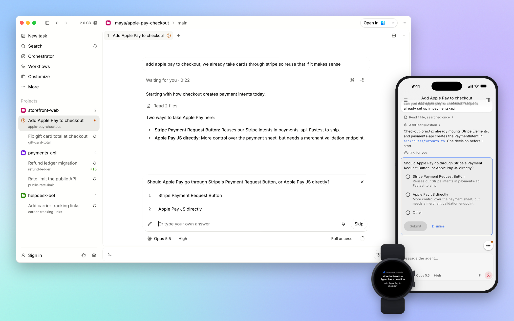
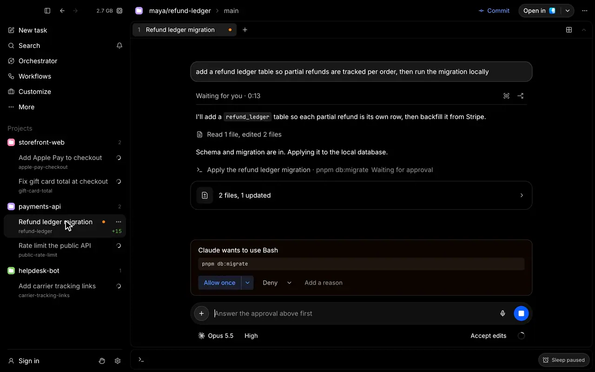
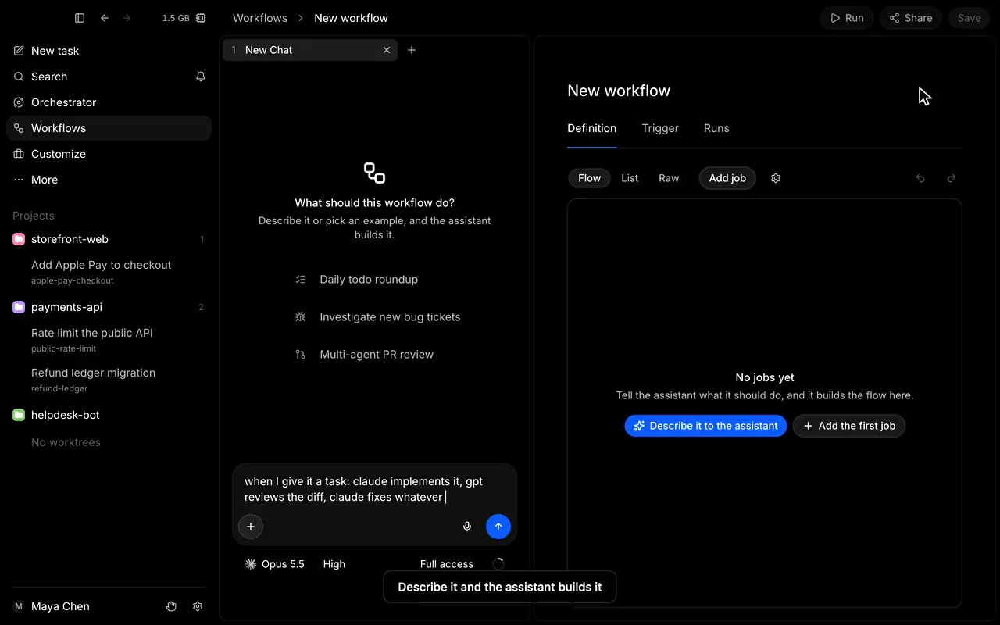
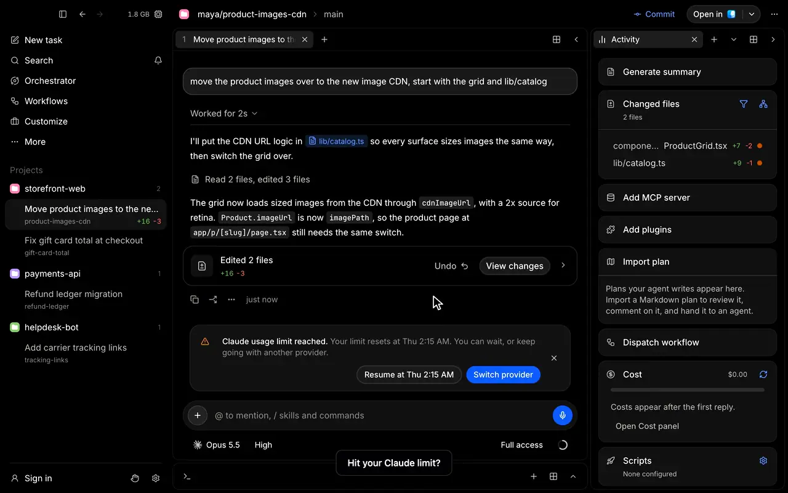

<h1 align="center">
  <picture>
    <source media="(prefers-color-scheme: dark)" srcset=".github/assets/logo-mark-dark.svg">
    
  </picture>
  Unstoppable Code
</h1>

  
  

  <strong>Run a fleet of coding agents without babysitting them.</strong> 
  Run Claude Code, Codex, Cursor, and local models in parallel, each in its own
  worktree, on the subscriptions you already have. Get a ping on your phone when
  one needs you, and switch providers when you hit a limit.

<h3 align="center"><a href="#download">Download Unstoppable Code</a></h3>

  <a href="#building-from-source">Build from source</a> · <a href="https://unstoppable.ai/support">Docs</a>

<picture>
  <source media="(prefers-color-scheme: dark)" srcset=".github/assets/hero-dark.png">
  
</picture>

## Agents scale. Your attention doesn't.

<table>
<tr>
<td width="50%" valign="middle">

### Quiet until it's your turn

Agents work in the background and the app stays muted. When one needs an
approval or an answer, it lights up so you know where to look, and your phone
gets a push so you can reply from wherever you are.

[Watch the full demo →](https://storage.googleapis.com/unstoppable-client-assets/images/homepage/unstoppable-code/demos/hero-dark-281511986be7.mp4) · [Light mode](https://storage.googleapis.com/unstoppable-client-assets/images/homepage/unstoppable-code/demos/hero-light-1eec784f253c.mp4)

</td>
<td width="50%">
  
</td>
</tr>
<tr>
<td width="50%" valign="middle">

### Mix models in one workflow, then share it

Use each model for what it's best at. Ask the built-in assistant for a
workflow where Claude builds, GPT reviews, and your tests run last. Tweak any
step by hand, then share it with your team.

[Watch the full demo →](https://storage.googleapis.com/unstoppable-client-assets/images/homepage/unstoppable-code/demos/workflow-dark-56eba5788788.mp4) · [Light mode](https://storage.googleapis.com/unstoppable-client-assets/images/homepage/unstoppable-code/demos/workflow-light-8c6433038ba3.mp4)

</td>
<td width="50%">
  
</td>
</tr>
<tr>
<td width="50%" valign="middle">

### Hit a usage limit? Keep going

When your Claude plan hits its limit, switch the same chat to another
provider, or to an open model through
[your own AI gateway](docs/ai-gateway.md), such as OpenRouter, and pick up
where you left off.

[Watch the full demo →](https://storage.googleapis.com/unstoppable-client-assets/images/homepage/unstoppable-code/demos/limit-dark-7b51a9bd5f8d.mp4) · [Light mode](https://storage.googleapis.com/unstoppable-client-assets/images/homepage/unstoppable-code/demos/limit-light-bf934b62fd41.mp4)

</td>
<td width="50%">
  
</td>
</tr>
</table>

### And more

- **Every agent, on your subscription:** run Claude Code, Codex, and Cursor on
  the Claude, ChatGPT, or Cursor plans you already pay for. Your provider's plan
  terms and usage limits still apply. You can also use local models or choose
  hosted models with AI credits.
- **As many as you need, in parallel:** each task gets its own worktree,
  terminal, and browser, grouped by repo. Quit or reboot and the list comes
  back.
- **Pipelines on a schedule:** chain prompts and scripts across agents, and
  start them on a schedule or a hook.
- **Chat or terminal, your call:** switch any Claude chat to terminal mode and
  keep your hooks, status line, `CLAUDE.md`, and skills. Switch back anytime;
  it's the same session.
- **Bring your setup with you:** import your projects, chats, and memory from
  Claude Code and Codex. The skills and plugins you already use keep working.
- **Respond on the go:** use the mobile app to answer an agent and keep work
  moving on a connected desktop when you're away from your desk.

The desktop and mobile clients are MIT-licensed;
hosted services such as accounts and cloud features are not included in this
repository.

## Download

| Platform              | Download                                                                                              |
| --------------------- | ----------------------------------------------------------------------------------------------------- |
| macOS (Apple Silicon) | [Download for Apple Silicon](https://unstoppable.ai/download/started?platform=macArm64&source=github) |
| macOS (Intel)         | [Download for Intel](https://unstoppable.ai/download/started?platform=macIntel&source=github)         |
| Windows (x64)         | [Download for Windows](https://unstoppable.ai/download/started?platform=windowsX64&source=github)     |
| Linux (x64)           | [Download for Linux x64](https://unstoppable.ai/download/started?platform=linuxX64&source=github)     |
| Linux (arm64)         | [Download for Linux arm64](https://unstoppable.ai/download/started?platform=linuxArm64&source=github) |

- **Phone or tablet:** get the app on the
  [App Store](https://apps.apple.com/us/app/unstoppable-ai/id6786961568), or
  find the Google Play link on the [download page](https://unstoppable.ai/download).
- **Every option** is on [unstoppable.ai/download](https://unstoppable.ai/download).
- **Linux** packages are `.deb` files for Ubuntu 24.04 LTS or newer. Arch
  Linux installs from a pacman repository; see the
  [download page](https://unstoppable.ai/download).
- **macOS with Homebrew:** run
  `brew install --cask unstoppableweb/tap/unstoppable-code`. Homebrew picks
  the right build for your Mac, and the app keeps itself up to date. See
  [Install with Homebrew](https://unstoppable.ai/support/getting-started/install-the-app#install-with-homebrew)
  and the [tap](https://github.com/unstoppableweb/homebrew-tap).
- **Not sure which Mac you have?** See
  [Install the desktop app](https://unstoppable.ai/support/getting-started/install-the-app).

> [!NOTE]
> Agents need a model to run. Connect Claude, Codex, or a local model, or buy
> AI credits in your account. See
> [Connect Claude, Codex, or a local model](https://unstoppable.ai/support/agents-and-models/connect-claude-codex-or-a-local-model).

## Building from source

Each client builds on its own from a clone of this repository. Follow the README
in [`clients/desktop`](clients/desktop/README.md) or
[`clients/mobile`](clients/mobile/README.md) for what to install and which
commands to run.

Desktop builds use stable hosted service defaults. To build the desktop app
with every hosted service off, use `pnpm run build:local`; see
[Build without our services](clients/desktop/README.md#build-without-our-services).
Mobile connectivity depends on generated brand configuration and build settings. Follow each client's README
for configuration; a successful build alone does not verify sign-in or cloud
features.

- [Desktop source and build instructions](clients/desktop/README.md)
- [Mobile source and build instructions](clients/mobile/README.md)

## What runs on our servers

Accounts, AI credits, Remote Control, cloud chats, and a few other features
rely on services we run. [What runs on our servers](HOSTED-SERVICES.md) lists
each one, the data it handles, and the telemetry the apps send. To run Claude
Code and Codex chats through a gateway you control, see
[Use your own AI gateway](docs/ai-gateway.md).

## Documentation

The [help centre](https://unstoppable.ai/support) covers the app in depth. New
here? Start with
[How Unstoppable Code works](https://unstoppable.ai/support/getting-started/how-unstoppable-code-works).

- [Getting started](https://unstoppable.ai/support/getting-started)
- [Agents and models](https://unstoppable.ai/support/agents-and-models)
- [Accounts and billing](https://unstoppable.ai/support/accounts-and-billing)
- [Work without code](https://unstoppable.ai/support/work-without-code)
- [Troubleshooting](https://unstoppable.ai/support/troubleshooting)

## What's in this repository

- [`clients/desktop/`](clients/desktop/README.md): the desktop app for macOS, Windows, and Linux
- [`clients/mobile/`](clients/mobile/README.md): the iOS and Android app

Each folder holds its latest exported source, which may be a development
snapshot rather than a release. Snapshots are ordinary commits without a tag
or GitHub release. Tags named `source-desktop/<version>` and
`source-mobile/<version>` identify releases. The two folders update independently
and can represent different revisions. Mobile source may appear before its first
release tag.

## Source publishing and contributions

We publish client source under the MIT License with every release and as
development snapshots from main, so you can read it, audit it, build it, and
fork it. Snapshots can be synced manually or daily. They may be stale when
syncs are disabled, delayed, or failed.

This repository holds the desktop and mobile apps only. Our hosted services,
like accounts and cloud features, stay closed source.
[What runs on our servers](HOSTED-SERVICES.md) lists them, and each client's
build instructions cover service configuration. We don't take pull requests
here: we build every fix ourselves, so a clear issue is the best way to help.

## Getting help

- **Questions and how-to:** search the [help centre](https://unstoppable.ai/support)
  or [contact support](https://unstoppable.ai/support/troubleshooting/contact-support).
- **Bugs and ideas:** [open an issue](https://github.com/unstoppableweb/unstoppable-code/issues/new/choose).
  See [CONTRIBUTING.md](CONTRIBUTING.md) for what helps us most.
- **Security issues:** don't open a public issue. See [SECURITY.md](SECURITY.md).

## License

The first-party client source is licensed under the MIT License. See [LICENSE](LICENSE).
Third-party code and assets retain their own licenses and restrictions; see each
client's `THIRD_PARTY_NOTICES.txt` and accompanying license files.
